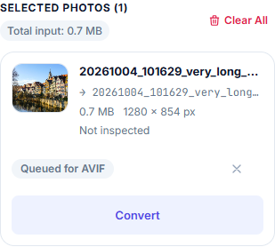

# Mobile UI responsiveness fixes

23 October 2026. Focused changes to the existing design; no redesign, deployment, push, infrastructure update, SEO rewrite or conversion-algorithm change. Earlier uncommitted work was preserved.

## What the screenshot revealed and what was reproduced

The screenshot shows the selected-file row using a desktop horizontal layout on a phone. The action group has `shrink-0`, while the information group has `flex-1 min-w-0`; the action buttons consume most or all of the width. Text and metadata wrap into a vertical column, and the image's max-width rule can reduce the thumbnail almost to nothing. The prototype's `.viewport-mobile-frame .file-row-item` stacking rules do not apply to real browser viewports.

The existing card also uses 20px mobile body padding; its format tabs have small targets, source/output badges compete for one line, file toolbar controls wrap awkwardly, range inputs have only 8px layout height, and narrow table columns make long cells difficult to read. Footer links are small inline targets. These were inspected in the actual renderer, generated client, original markup and computed browser layout before changes.

Before measurements with a real HEIC fixture and a long camera filename:

|AVIF viewport|File information width|Thumbnail width|File row height|Result|
|---|---:|---:|---:|---|
|320px|0px|2px|286px|Information collapsed; actions extended beyond the row|
|375px|33.4px|33.4px|286px|Severely cramped text/thumbnail|
|430px|88.4px|56px|286px|Thumbnail visible, detail column still cramped|

The page's outer `scrollWidth` was not enough to detect this defect: the surrounding converter card clips overflow. Verification therefore also measures the row's information, image and action rectangles. Testing used fixture photos rather than the private photograph shown in the user's screenshot.

## Implementation and exact files changed in this task

|File|Changes|
|---|---|
|`src/design/helpers.js`|Add stable styling hooks to the existing file row/info/thumbnail/name/metadata markup. Preserve existing event hooks and operations. Add filename/output-name titles; full text stays in the accessible DOM|
|`src/lib/design.mjs`|Add classes to existing converter card/header/tabs/indicators, file toolbar and settings summary. Give existing converter-table wrappers a name, focusability and region semantics. Mark existing small illustrations for safe wrapping|
|`src/styles/approved.css`|Scoped real-mobile rules at max-width 767px, filename width/ellipsis safeguards, table focus outline and reduced-motion support|
|`tests/mobile-ui.spec.ts`|Four browser tests covering the viewport matrix, tables, filenames, targets, settings, errors, text enlargement and reduced motion|
|`tests/mobile-conversions.mjs`|Repeatable touch-enabled Chromium upload/convert/ZIP/clear smoke test for all three output formats|
|`MOBILE_UI_FIX_REPORT.md`|This report|
|`reports/mobile-ui/avif-selected-320-before.png`, `reports/mobile-ui/avif-selected-320-after.png`|Retained file-card screenshots|
|`reports/mobile-ui/avif-selected-375-before.png`, `reports/mobile-ui/avif-selected-375-after.png`|Retained file-card screenshots|
|`reports/mobile-ui/avif-selected-430-before.png`, `reports/mobile-ui/avif-selected-430-after.png`|Retained file-card screenshots|
|`reports/mobile-ui/avif-page-375-before.png`, `reports/mobile-ui/avif-page-375-after.png`|Retained full mobile-page screenshots|
|`reports/mobile-ui/desktop-avif-1440-before.png`, `reports/mobile-ui/desktop-avif-1440-after.png`|Retained desktop-page comparison|
|`reports/mobile-ui/desktop-avif-file-1440-before.png`, `reports/mobile-ui/desktop-avif-file-1440-after.png`|Retained normal desktop file-row comparison|

`src/scripts/client.ts` was already replaced by the ignored `src/generated/client.ts` in the preceding build-safety work. This task inspected that generation path and changed the UI renderer source, not a nonexistent legacy client file. Normal builds regenerate the ignored client/CSS outputs. No package, dependency, public branding/font asset, Nginx, Cloudflare or VPS change was made in this task.

## Responsive behavior and selectors

- **Converter card:** `.converter-card-header` and `.converter-card-body` use 12px/16px mobile padding. The card stays within its existing margins, border, radius and shadow. `.converter-action-bar` and its existing action group stack full-width on phones; upload, conversion, downloads, clear, advanced, error dismissal and success-download controls have practical 44px target heights.
- **Format tabs:** `.converter-format-tabs` uses three equal minmax columns with centered labels and 44px targets. Existing selected colors/states, all three options and route links remain. Source/output indicators wrap into readable full rows; only the decorative arrow is omitted on mobile. Labels can wrap naturally when text is enlarged.
- **Selected files:** `.file-row-item` stacks the information and action groups. `.file-row-info` has full width; `.file-row-thumbnail` is 64×56px. `.file-input-name`/`.file-output-name` use ellipsis with full accessible text/titles. `.file-row-meta` keeps all values readable; only decorative bullet separators are omitted on phones. `.file-row-actions` places status and 44×44 remove control on one row and the existing Convert/Download action full-width below. Error details wrap rather than disappear.
- **Toolbar/settings:** `.file-list-toolbar`, `.file-list-summary` and `#batch-summary-pill` avoid splitting the size/MB value. Quality labels/percentages wrap cleanly; JPG legend labels use a two-column grid. The slider's total hit area is 44px while its visual track remains 8px using padding/background clipping. Existing sliders, values, chroma choices, limits, defaults and advanced settings are unchanged. Selects/size fields fit their panel with at least 44px height.
- **Tables:** `.mobile-table-scroll` and existing `.article-table-scroll` keep semantic tables and horizontal scrolling. Mobile tables use a 36rem minimum width, 13px text and comfortable line height, so columns remain readable rather than squeezing into the viewport. Wrappers are named/focusable; a visible focus outline and native scrolling expose the final columns. No global overflow:hidden concealment was added.
- **Reading/footer:** Existing 15px article paragraphs and 16px hero descriptions were retained. Only small tool instructions, metadata, settings and footer copy receive scoped mobile readability adjustments. Footer lists keep every original link/group and logo; links are at least 44px high with redundant inter-item margins removed. The footer grows to accommodate usable targets, not new sections. Its measured height at 375px changes from about 788px to 1106px; inter-group spacing is reduced from 32px to 24px.
- **Accessibility/reflow:** Mobile menu/drawer links, blog controls and mobile TOC disclosures get usable targets. The toast stays inside narrow screens. Mobile inherited word wrapping prevents enlarged headings/illustration labels from painting beyond their boxes; `.mobile-wrap-illustration` permits existing diagram labels to wrap. The menu icon remains 44px when root text size doubles. `html.scroll-smooth` and `.transition-soft` respect prefers-reduced-motion. The stronger selector fixes the original smooth-scroll specificity conflict.

The mobile breakpoint is below 768px. At 768px and above, the established layout remains; the only intentional all-width file-row correction is capping/ellipsizing an overlong filename/output name that would otherwise overlap controls. Normal desktop file rows are unchanged. No SEO wording was edited.

## Before and after screenshots

54 actual before/after screenshot pairs were captured under ignored `.astro/mobile-ui-before/` and `.astro/mobile-ui-after/`; 12 selected PNGs are retained under `reports/mobile-ui/` for review with this report. The baseline is this task's current site, not the original prototype.

|Comparison|Before|After|
|---|---|---|
|320px AVIF file row|[Before](reports/mobile-ui/avif-selected-320-before.png)|[After](reports/mobile-ui/avif-selected-320-after.png)|
|375px AVIF file row|[Before](reports/mobile-ui/avif-selected-375-before.png)|[After](reports/mobile-ui/avif-selected-375-after.png)|
|430px AVIF file row|[Before](reports/mobile-ui/avif-selected-430-before.png)|[After](reports/mobile-ui/avif-selected-430-after.png)|
|375px full AVIF page|[Before](reports/mobile-ui/avif-page-375-before.png)|[After](reports/mobile-ui/avif-page-375-after.png)|
|1440px desktop AVIF page|[Before](reports/mobile-ui/desktop-avif-1440-before.png)|[After](reports/mobile-ui/desktop-avif-1440-after.png)|
|1440px normal file row|[Before](reports/mobile-ui/desktop-avif-file-1440-before.png)|[After](reports/mobile-ui/desktop-avif-file-1440-after.png)|

375px selected-file example after the fix:

After AVIF measurements with the same long-name fixture:

|Viewport|Information width|Thumbnail|Row height|Actions|
|---|---:|---|---:|---|
|320px|228px|64×56px|219.1px|Full-width Convert, separate 44px remove target|
|375px|283px|64×56px|219.1px|Same layout; no vertical-letter squeezing|
|430px|338px|64×56px|197.9px|More metadata fits naturally on a line|

## Test results

|Check|Result|
|---|---|
|`npm run check`|Pass: application and worker TypeScript|
|`npm run build`|Pass: 19 static HTML documents and unchanged 18-URL sitemap|
|`npm test -- --reporter=list`|**36/36 pass**, final run approximately 1.8 minutes|
|Page/viewport matrix|18 published/support/legal pages × 9 widths = **162 checks**, no document horizontal overflow|
|Requested widths|320, 360, 375, 390, 414, 430, 768, 1024, 1440px|
|Long-name queues|All PNG/JPG/AVIF tools at all 9 widths: **27 queue layouts**, previews visible, name title exact, controls contained; 44px mobile targets|
|Tables|All rendered main tables have scrollable wrappers and named keyboard regions; keyboard ArrowRight tested at the narrowest width; final-column access checked wherever overflow exists throughout the matrix|
|Quality/advanced controls|JPG 85→86 and AVIF 78→79 keyboard changes show correct values; custom resize controls usable; lossless disables quality, 4:4:4 restores it; no default or encoder change|
|Errors/focus/motion|Invalid long-named file shows a wrapping alert; remove/clear targets retained; named table focus works; existing menu/FAQ/Escape tests pass; reduced-motion check passes|
|Text enlargement|320px homepage with 200% root text size fits after necessary wrapping; 640×450 CSS viewport checks equivalent reflow for a 1280×900 desktop at 200% browser zoom|
|`node tests/mobile-conversions.mjs`|Pass: touch-enabled 375px Chromium chooser/Convert/ZIP/Clear for PNG, JPG, AVIF; two unique files per ZIP, each genuinely decodes at 1280×854|
|Console/network observations|No page exceptions in the matrix, queues or mobile conversion smoke; mobile smoke observes no POST uploads. Full existing AVIF tests verify actual worker/WASM requests and CSP compatibility|
|Own desktop comparison|**17/17 sampled desktop/tablet pairs show zero differing pixels** at pixelmatch threshold 0.1: four empty page types at 1024/1440 plus normal file rows for all three converters at 768/1024/1440|
|Existing historical visual script|Completed all **30 cases**, exit 0. It compares an older prototype, has no acceptance threshold and includes earlier approved branding/content differences; it is not a pixel-perfect pass/fail baseline|
|SEO preservation|All **19 HTML heads** have identical title/meta/canonical/JSON-LD values before/after; sitemap.xml and robots.txt are byte-identical; no route or indexing change|
|Protected sources|All 13 Markdown articles, conversion runtime/worker/AVIF encoder, URL/schema/sitemap helpers and public font/brand assets remain unchanged from this task's baseline|
|Whitespace|`git diff --check` passes; LF→CRLF notices from Windows are not errors|

The full suite also exercises real PNG/JPG/AVIF downloads, duplicate-name ZIPs, orientation, quality/chroma/lossless behavior, resize, cancellation, retry, corrupt/renamed input, real upload thumbnails, blog filters/navigation and static SEO. The touch smoke opens the real file chooser through a tap and uses the actual decoder/encoder output, not fake UI success. It is browser device emulation, not physical iPhone/Android testing.

To repeat the standalone touch smoke, first build and run `node tests/server.mjs` in a separate terminal on loopback port 4876, then run `node tests/mobile-conversions.mjs`. The normal `npm test` command manages its verification server through Playwright. Never publish the test server or test fixtures.

## Remaining limits and manual review

- Native iOS Safari/macOS Safari/Android browser picker/download handling, Firefox/Edge, physical touch ergonomics, screen-reader announcements and actual browser-menu zoom need real-device coverage. The automated text-size and equivalent-reflow tests do not constitute a complete WCAG audit.
- Very large/mixed/camera-specific HEIC batches and memory-limited phones remain subject to the existing documented codec/memory limits. This task changes no file limits or algorithms.
- Native select controls can abbreviate a long selected label while closed; the mode remains identifiable and the original complete option text is available in the open control/accessible options. No option or encoding setting was hidden or shortened.
- Additional phone viewport height is intentional where full-width actions, readable settings and 44px footer links need space. No claim is made that every mobile page has the same height as before.
- Historical prototype differences are expected and cannot certify the current design by themselves. The actual pre-task desktop snapshots establish the tested preservation result.
- No deployment or infrastructure change was performed; the existing site preview was left running. Only the temporary local test server was stopped after verification. Earlier uncommitted work remains uncommitted and intact.
